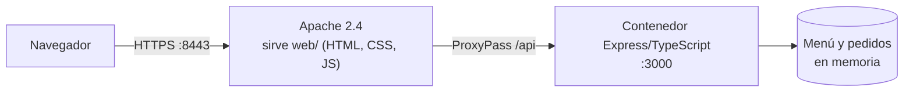
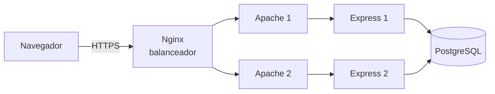

# Mamá Toyo – Pedidos para llevar y menú del día

Proyecto de Cátedra · Gestión de Servidores Web · Sección A · Laboratorio 3 · UNIVO

Sistema web de pedidos para llevar y menú del día del **Comedor Mamá Toyo** (San Miguel, El Salvador).
El local es pequeño y en el almuerzo se forman filas: el sitio permite ver el menú, pedir con anticipación
y le da a la cocina una lista de pedidos pendientes. El menú y los precios son los del comedor
(ver [docs/MENU.md](docs/MENU.md)); cada plato tiene un precio mínimo y uno máximo.

## Arquitectura (Fase 2: contenedor + servidor web + HTTPS)



Un solo comando levanta Apache y el contenedor Express (Docker Compose). Apache entrega la interfaz estática de
`web/` y reenvía las peticiones `/api/...` al contenedor con `ProxyPass`. La explicación completa, paso a paso,
está en [docs/ARQUITECTURA.md](docs/ARQUITECTURA.md).

**Arquitectura objetivo (Fases 3 y 4):** clúster con balanceo de carga, decidido en [docs/DECISIONES.md](docs/DECISIONES.md).



## Cómo levantarlo (Fase 2)

**Requisitos:** Docker Desktop abierto, Git Bash y [mkcert](https://github.com/FiloSottile/mkcert)
(`winget install FiloSottile.mkcert`). Con mkcert el navegador muestra el candado sin advertencias; sin él, funciona con
un certificado autofirmado y el navegador avisa.

```bash
git clone https://github.com/JeffersonUU7/mama-toyo-pedidos.git
cd mama-toyo-pedidos

bash certs/generar-certificado.sh                                   # una sola vez: crea el certificado HTTPS local
docker compose -f apache/docker-compose.apache.yml up --build      # Apache + contenedor Express
```

Abre <https://localhost:8443> (menú y pedido) y <https://localhost:8443/cocina.html> (vista de cocina).
HTTP en <http://localhost:8081> redirige a HTTPS. Para detener: `Ctrl + C` y luego
`docker compose -f apache/docker-compose.apache.yml down`.

Las llaves privadas (`.key`) **no** se suben al repositorio: están en `.gitignore`.

### Solo la API, sin Docker

```bash
npm install
npm run dev
```

Prueba: <http://localhost:3000/api/menu>

## API

Todas las rutas están bajo `/api` (la ruta que reenvía Apache). Cada respuesta incluye `node`, que indica qué nodo la atendió.

| Ruta | Método | Función |
|---|---|---|
| `/api/health` | GET | Responde 200 si el contenedor funciona |
| `/api/menu` | GET | Los platos del día con su precio mínimo y máximo |
| `/api/pedidos` | POST | Crea un pedido y devuelve su número de confirmación |
| `/api/pedidos/:numero` | GET | Consulta un pedido |
| `/api/cocina` | GET | Pedidos pendientes, en orden de llegada |

Las mismas rutas existen también sin el prefijo `/api` (por ejemplo `/health`): las usan el balanceador Nginx, el
health check de Docker y las pruebas de carga.

Ejemplo de pedido:

```bash
curl -k -X POST https://localhost:8443/api/pedidos \
  -H "Content-Type: application/json" \
  -d '{"cliente":"Ana","items":[{"platoId":1,"cantidad":2},{"platoId":10,"cantidad":1}]}'
```

El total del pedido se devuelve como rango (`totalMin` y `totalMax`), igual que los precios del menú.

## HTTPS y evidencias

El servidor web escucha de forma segura (TLS 1.2 y 1.3) y redirige HTTP a HTTPS. Las capturas del sitio con el candado,
del certificado y de la aplicación funcionando están en [docs/evidencias](docs/evidencias/README.md).

## Estructura del repositorio

```
src/                  Contenedor: API Express/TypeScript
web/                  Interfaz estática (HTML, CSS, JS) que sirve Apache
apache/               Configuración de Apache (HTTPS + reverse proxy) y su docker-compose
certs/                Script que genera el certificado (las llaves no se suben)
nginx/                Configuración del balanceador (Fase 3)
docs/                 Arquitectura, decisiones, menú, evidencias y planes
avances/              Registro de avances de cada integrante
Dockerfile            Imagen del contenedor Express
docker-compose.yml    Clúster: 2 nodos + Nginx (Fase 3)
```

## Equipo

| N.º | Nombre | Responsabilidad principal |
|---|---|---|
| 1 | Jefferson Requeno | Coordinación y documentación |
| 2 | Brissvey Calderon | Contenedor Express/TypeScript |
| 3 | Yessica Medrano | Interfaz de menú y pedidos |
| 4 | Josue Zelaya | Servidor web y HTTPS |
| 5 | Juan Flores | Clúster Docker y Nginx |
| 6 | Randal Lopez | Pruebas de carga y monitoreo |

## Documentación y forma de trabajo

- [docs/ARQUITECTURA.md](docs/ARQUITECTURA.md): cómo se conectan las piezas.
- [docs/SERVIDOR_WEB.md](docs/SERVIDOR_WEB.md): Apache, HTTPS y reverse proxy.
- [docs/DECISIONES.md](docs/DECISIONES.md): decisiones técnicas.
- [docs/ORDEN_DE_TRABAJO.md](docs/ORDEN_DE_TRABAJO.md) y [docs/REPARTO.md](docs/REPARTO.md): orden y reparto de tareas.
- [CONTRIBUTING.md](CONTRIBUTING.md): ramas y Pull Requests. Nuevos integrantes: [LEEME_PRIMERO.txt](LEEME_PRIMERO.txt).

## Entregas

| Entrega | Contenido | Peso |
|---|---|---|
| Clase 29 | Propuesta de equipo y tema | 10 % |
| Clase 33 (Fase 2) | Contenedor Express/TypeScript, Apache con reverse proxy y HTTPS, documentación | 20 % |
| Clase 36 | Demo del clúster con balanceo de carga funcionando | 20 % |
| Clase 39 | Entrega final y defensa | 50 % |
