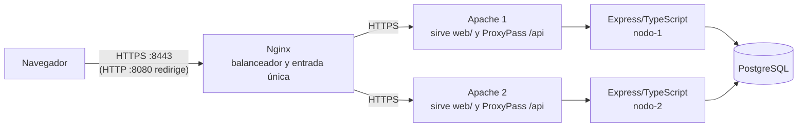

# Mamá Toyo – Pedidos para llevar y menú del día

Proyecto de Cátedra · Gestión de Servidores Web · Sección A · Laboratorio 3 · UNIVO

Sistema web de pedidos para llevar y menú del día del **Comedor Mamá Toyo** (San Miguel, El Salvador).
El local es pequeño y en el almuerzo se forman filas: el sitio permite ver el menú, pedir con anticipación
y le da a la cocina una lista de pedidos pendientes. El menú y los precios son los del comedor
(ver [docs/MENU.md](docs/MENU.md)); cada plato tiene un precio mínimo y uno máximo.

## Arquitectura



Todo corre en Docker Compose. **Nginx** es el único punto de entrada: termina el HTTPS, reparte las peticiones entre los dos nodos
(round-robin) y, si un nodo falla, reintenta en el otro (failover). Cada nodo es un **Apache** con HTTPS que entrega la interfaz estática de
`web/` y reenvía `/api/...` con `ProxyPass` a su contenedor **Express/TypeScript**; los dos nodos son idénticos y guardan los pedidos en el mismo
**PostgreSQL**. La explicación paso a paso está en [docs/ARQUITECTURA.md](docs/ARQUITECTURA.md) y las decisiones en [docs/DECISIONES.md](docs/DECISIONES.md).

| Pieza | Qué hace | Dónde está |
|---|---|---|
| Nginx | Entrada única, HTTPS, balanceo, failover, límite de peticiones y login de cocina | `nginx/` |
| Apache (×2) | HTTPS, entrega `web/`, `ProxyPass /api` hacia su Express | `apache/` |
| Express/TypeScript (×2) | API del comedor: menú, pedidos, cocina; `/api/health` y `/api/ready` | `src/`, `Dockerfile` |
| PostgreSQL | Pedidos persistentes | `docker-compose.yml` |

## Cómo levantar solo Apache + Express (Fase 2)

**Requisitos:** Docker Desktop abierto, Git Bash y [mkcert](https://github.com/FiloSottile/mkcert)
(`winget install FiloSottile.mkcert`). Con mkcert el navegador muestra el candado sin advertencias; sin él, funciona con
un certificado autofirmado y el navegador avisa.

```bash
git clone https://github.com/JeffersonUU7/mama-toyo-pedidos.git
cd mama-toyo-pedidos

bash certs/generar-certificado.sh                                   # una sola vez: crea el certificado HTTPS local
docker compose -f apache/docker-compose.apache.yml up --build      # Apache + contenedor Express
```

Abre <https://localhost:8443> (menú y pedido) y <https://localhost:8443/cocina.html> (vista de cocina).
HTTP en <http://localhost:8081> redirige a HTTPS. Para detener: `Ctrl + C` y luego
`docker compose -f apache/docker-compose.apache.yml down`.

Las llaves privadas (`.key`) **no** se suben al repositorio: están en `.gitignore`.

### Solo la API, sin Docker

```bash
npm install
npm run dev
```

Si abres la página desde otro puerto, arranca la API con `CORS_ORIGIN=http://localhost:5500 npm run dev` y abre la página con
`?api=http://localhost:3000/api` (solo se aceptan rutas relativas o `localhost`).

Prueba: <http://localhost:3000/api/menu>

## Cómo levantar el clúster (Fase 3 y entrega final)

Clúster de 2 nodos idénticos + Nginx como balanceador y entrada única + PostgreSQL (`docker-compose.yml`).

```bash
bash certs/generar-certificado.sh        # una sola vez
docker compose up --build -d
docker compose ps                        # db, app1, app2 "healthy"; apache1, apache2, nginx "Up"
curl -sk https://localhost:8443/api/health   # repetir: alterna nodo-1 / nodo-2
```

Entrada única: <https://localhost:8443> (el puerto 8080 redirige a HTTPS). Cocina: `/cocina.html` (usuario y clave de desarrollo en `docs/GUION_DEMO.md`).

**Health check:** `/api/health` (el proceso vive) y `/api/ready` (además llega a PostgreSQL); Docker los vigila con `HEALTHCHECK` cada 10 s y
Nginx marca un nodo como caído tras 2 fallos (`max_fails=2 fail_timeout=10s`).

**Failover:** `docker compose stop app1` → el sitio sigue respondiendo desde `nodo-2`; `docker compose start app1` lo reincorpora.
Evidencia automática: `bash docs/pruebas/evidencias-fase3.sh` (guarda `docs/evidencias/fase3/evidencia-fase3.txt`).
Permisos POSIX: `bash docs/pruebas/permisos.sh`.

## API

Todas las rutas están bajo `/api` (la ruta que reenvía Apache). Cada respuesta incluye `node`, que indica qué nodo la atendió.

| Ruta | Método | Función |
|---|---|---|
| `/api/health` | GET | Responde 200 si el contenedor funciona |
| `/api/ready` | GET | Responde 200 si el nodo además puede hablar con PostgreSQL (503 si no); es para monitoreo |
| `/api/menu` | GET | Los platos del día con su precio mínimo y máximo |
| `/api/pedidos` | POST | Crea un pedido y devuelve su número de confirmación |
| `/api/pedidos/:numero` | GET | Consulta un pedido |
| `/api/pedidos/:numero` | PATCH | Marca un pedido como listo (`{"estado":"listo"}`) |
| `/api/cocina` | GET | Pedidos pendientes, en orden de llegada |

Las mismas rutas existen también sin el prefijo `/api` (por ejemplo `/health`): las usan el health check de Docker y los Apache.

Ejemplo de pedido:

```bash
curl -k -X POST https://localhost:8443/api/pedidos \
  -H "Content-Type: application/json" \
  -d '{"cliente":"Ana","items":[{"platoId":1,"cantidad":2},{"platoId":10,"cantidad":1}]}'
```

Ejemplo de marcar pedido como listo:

```bash
curl -k -X PATCH https://localhost:8443/api/pedidos/1 \
  -H "Content-Type: application/json" \
  -d '{"estado":"listo"}'
```

El total del pedido se devuelve como rango (`totalMin` y `totalMax`), igual que los precios del menú.

## Clúster (Ronda 2 y 3)

El repositorio incluye `docker-compose.yml` con Nginx (balanceador + HTTPS), 2 nodos (`apache1` → `app1`, `apache2` → `app2`)
y PostgreSQL (`db`). Nginx habla con los Apache por HTTPS; cada Apache sirve `web/` y reenvía `/api` a su Express.
El balanceo y el failover funcionan; los pedidos se guardan en el PostgreSQL compartido.

```bash
bash certs/generar-certificado.sh   # una sola vez (el clúster monta certs/ en Nginx y en los Apache)
docker compose up --build           # levanta Nginx, apache1, apache2, app1, app2, db
```

Entrada: **<https://localhost:8443>** (menú y pedido). `http://localhost:8080` solo redirige a HTTPS.

**Cocina protegida:** `https://localhost:8443/cocina.html`, `GET /api/cocina` y `PATCH /api/pedidos/:numero` piden usuario y
contraseña (HTTP Basic en Nginx). Credenciales de **desarrollo**: usuario `cocina`, contraseña `toyo2026` (archivo `nginx/htpasswd`).
Para cambiarla: `openssl passwd -apr1 'nueva'` y reemplazar el hash en `nginx/htpasswd`. Crear y consultar un pedido sigue siendo
público (el cliente no tiene cuenta).

Simular falla de un nodo:

```bash
docker compose stop app1      # el sitio sigue respondiendo y los POST/PATCH se reintentan en el otro nodo
```

Variables (`.env.example`): `POSTGRES_PASSWORD`, y solo para desarrollo `CORS_ORIGIN` (CORS está cerrado por defecto;
en el clúster la página y la API comparten origen). En el clúster, `REQUIRE_DB=true` impide que un nodo arranque sin PostgreSQL.

## HTTPS y evidencias

El servidor web escucha de forma segura (TLS 1.2 y 1.3) y redirige HTTP a HTTPS. Las capturas del sitio con el candado,
del certificado y de la aplicación funcionando están en [docs/evidencias](docs/evidencias/README.md).

## Estructura del repositorio

```
src/                  Contenedor: API Express/TypeScript
web/                  Interfaz estática (HTML, CSS, JS) que sirve Apache
apache/               Configuración de Apache (HTTPS + reverse proxy) y su docker-compose
certs/                Script que genera el certificado (las llaves no se suben)
nginx/                Balanceador: nginx.conf, proxy.inc y htpasswd (clave de cocina)
docs/                 Arquitectura, decisiones, menú, evidencias y planes
avances/              Registro de avances de cada integrante
Dockerfile            Imagen del contenedor Express
docker-compose.yml    Clúster: Nginx (HTTPS) + 2 nodos (Apache + Express) + PostgreSQL
```

## Equipo

| N.º | Nombre | Responsabilidad principal |
|---|---|---|
| 1 | Jefferson Requeno | Coordinación y documentación |
| 2 | Brissvey Calderon | Contenedor Express/TypeScript |
| 3 | Yessica Medrano | Interfaz de menú y pedidos |
| 4 | Josue Zelaya | Servidor web y HTTPS |
| 5 | Juan Flores | Clúster Docker y Nginx |
| 6 | Randal Lopez | Pruebas de carga y monitoreo |

## Documentación y forma de trabajo

- [docs/ARQUITECTURA.md](docs/ARQUITECTURA.md): cómo se conectan las piezas.
- [docs/SERVIDOR_WEB.md](docs/SERVIDOR_WEB.md): Apache, HTTPS y reverse proxy.
- [docs/DECISIONES.md](docs/DECISIONES.md): decisiones técnicas.
- [docs/GUION_DEMO.md](docs/GUION_DEMO.md): guion paso a paso de la demo y preguntas probables de la defensa.
- [docs/SEGURIDAD_Y_MONITOREO.md](docs/SEGURIDAD_Y_MONITOREO.md): controles de seguridad aplicados y cómo se monitorea el clúster.
- [docs/PRUEBAS_DE_CARGA.md](docs/PRUEBAS_DE_CARGA.md): plan y resultados de las pruebas de carga (k6).
- [docs/ORDEN_DE_TRABAJO.md](docs/ORDEN_DE_TRABAJO.md) y [docs/REPARTO.md](docs/REPARTO.md): orden y reparto de tareas.
- [CONTRIBUTING.md](CONTRIBUTING.md): ramas y Pull Requests. Nuevos integrantes: [LEEME_PRIMERO.txt](LEEME_PRIMERO.txt).

## Entregas

| Entrega | Contenido | Peso |
|---|---|---|
| Clase 29 | Propuesta de equipo y tema | 10 % |
| Clase 33 (Fase 2) | Contenedor Express/TypeScript, Apache con reverse proxy y HTTPS, documentación | 20 % |
| Clase 36 | Demo del clúster con balanceo de carga funcionando | 20 % |
| Clase 39 | Entrega final y defensa | 50 % |