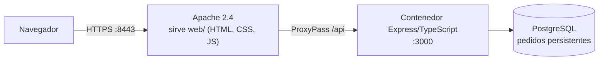
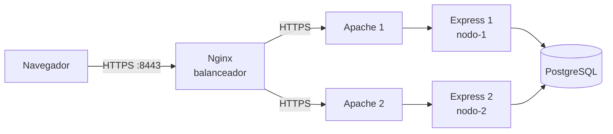
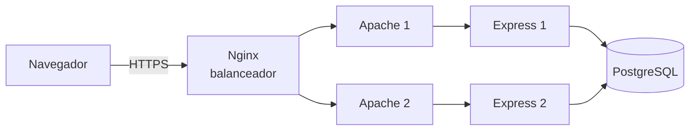

# Arquitectura

## Base: contenedor + Apache + HTTPS (Fase 2)

Todo corre en Docker Compose (`apache/docker-compose.apache.yml`), con un solo comando.
El contenedor Express usa PostgreSQL si existe `DATABASE_URL`; si no, usa memoria (para `npm run dev`).

| Pieza | Qué hace | Puerto | Dónde está |
|---|---|---|---|
| Navegador | Muestra la interfaz y llama a la API con `fetch('/api/...')` | | |
| Apache 2.4 | Entrega el HTML, CSS y JS de `web/`, termina el HTTPS y reenvía `/api` al contenedor | 8443 (HTTPS), 8081 (redirige a HTTPS) | `apache/httpd.conf` |
| Contenedor Express/TypeScript | La API del comedor: menú, pedidos, cocina y marcar listo | 3000 (solo dentro de la red de Docker) | `src/`, `Dockerfile` |
| Datos | Menú en `src/data.ts`; pedidos en PostgreSQL (o memoria si no hay `DATABASE_URL`) | | `src/data.ts`, `src/pedidos.ts` |

## Qué pasa cuando un cliente hace un pedido

1. El cliente abre `https://localhost:8443`. Apache responde con `index.html` y sus archivos (estáticos, de `web/`).
2. La página pide el menú con `GET /api/menu`. Apache ve que la ruta empieza con `/api` y, por la regla `ProxyPass`,
   la reenvía a `http://app:3000/api/menu`, al contenedor Express.
3. Express responde con el menú en JSON. Apache lo devuelve al navegador, que lo muestra.
4. El cliente arma su pedido y la página envía `POST /api/pedidos`. Express valida los datos, calcula el total
   (como rango, porque los precios del comedor son un mínimo y un máximo), guarda el pedido en PostgreSQL
   y devuelve su número.
5. La cocina abre `cocina.html`, que consulta `GET /api/cocina` cada 5 segundos para ver los pedidos pendientes.
6. Cuando la cocina prepara un pedido, envía `PATCH /api/pedidos/:numero` con `{"estado":"listo"}`.
   El pedido desaparece de la vista de cocina y queda marcado como listo en la base de datos.

## Seguridad

- HTTPS con TLS 1.2 y 1.3 únicamente. El puerto 80 (publicado como 8081) redirige a HTTPS.
- Certificado local generado con mkcert (candado sin advertencias) o autofirmado con openssl como alternativa.
- La llave privada (`certs/server.key`) está en `.gitignore` y no se sube al repositorio.
- Apache oculta su versión, no lista directorios y envía las cabeceras `X-Content-Type-Options` y `X-Frame-Options`.
- El contenedor Express no se publica al exterior: solo Apache puede llegar a él.
- La API valida los datos de entrada (cantidad de 1 a 20 por plato, hasta 20 líneas, nombre de hasta 60 caracteres).

## Arquitectura final: clúster con Nginx (Fase 3 y entrega final)

`docker-compose.yml` levanta:

- **Nginx** (`nginx:1.27-alpine`): único punto de entrada. HTTPS en `:8443` (TLS 1.2/1.3), `:8080` redirige a HTTPS.
  Balanceo round-robin con `zone` compartida; `resolve` para volver a consultar la IP de los Apache; failover pasivo
  (`max_fails=2`, `fail_timeout=10s`) que también reintenta POST y PATCH ante 500, 502, 503 o timeout; límite de 30 escrituras/s por IP;
  cuerpo máximo de 16 kb; usuario y contraseña para la cocina.
- **2 Apache** (`apache1`, `apache2`): HTTPS en el puerto 443 interno, sirven `web/` y reenvían `/api` a su Express.
- **2 nodos Express** (`app1`, `app2`) con `NODE_ID`, `DATABASE_URL` y `REQUIRE_DB=true`; corren como usuario `node` (no root).
- **PostgreSQL 16** con volumen `pgdata` y healthcheck. Es un punto único de falla (límite declarado en la Decisión 1).

**Limitaciones conocidas (declararlas en la defensa):** Nginx no verifica el certificado de los Apache (red interna de Docker,
certificado de desarrollo); la contraseña de cocina es HTTP Basic con credencial de desarrollo; `GET /api/pedidos/:numero` es
público por diseño (quien adivine un número ve ese pedido); un solo PostgreSQL.

## Cómo se llegó a esta arquitectura (Decisión 2)

- **Nginx** es el punto de entrada único: reparte las peticiones y deja de enviar tráfico a un nodo que no responda.
- Cada **nodo** repite lo de la Fase 2: un Apache que sirve `web/` y reenvía a su Express.
- **PostgreSQL** guarda los pedidos fuera de los nodos, para que los dos nodos vean los mismos pedidos.
- Se construye por etapas. Los detalles y el plan alternativo están en [DECISIONES.md](DECISIONES.md).

**Etapas (Decisión 2):**

1. ✅ **Etapa 1 (Clase 36).** Nginx balancea los dos Express, que ya existen, y se agrega PostgreSQL. La interfaz se sigue viendo con el Apache independiente (`apache/docker-compose.apache.yml`). **Hecho.**
2. ✅ **Etapa 2.** Cada nodo tiene su Apache, que sirve `web/` y reenvía a su Express. Nginx balancea hacia los Apache. **Hecho** (Josué y Juan).
3. ✅ **Etapa 3.** HTTPS en Nginx con un certificado autofirmado de `certs/`. Nginx habla por HTTPS con los Apache. **Hecho** (validado con `docker compose up` el 22/11/2026).

**Plan B (no fue necesario; se mantiene como referencia)** (propuesta de Josué): Apache delante de Nginx. Se cambia el `ProxyPass` a `http://nginx:80` y se unen ambos compose a la misma red. Funciona con pocos cambios, pero el balanceador deja de ser la entrada y Apache pasa a ser un punto único de falla. La coordinación decide si se usa al terminar la Clase 36.