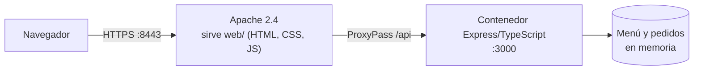
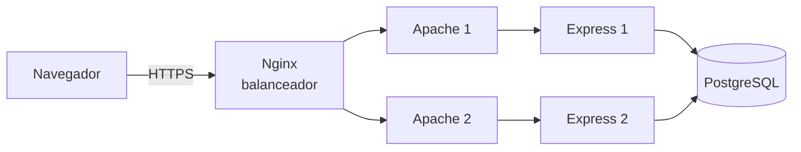

# Arquitectura

## Fase 2: lo que funciona hoy

Todo corre en Docker Compose (`apache/docker-compose.apache.yml`), con un solo comando.

| Pieza | Qué hace | Puerto | Dónde está |
|---|---|---|---|
| Navegador | Muestra la interfaz y llama a la API con `fetch('/api/...')` | | |
| Apache 2.4 | Entrega el HTML, CSS y JS de `web/`, termina el HTTPS y reenvía `/api` al contenedor | 8443 (HTTPS), 8081 (redirige a HTTPS) | `apache/httpd.conf` |
| Contenedor Express/TypeScript | La API del comedor: menú, pedidos y cocina | 3000 (solo dentro de la red de Docker) | `src/`, `Dockerfile` |
| Datos | Menú y pedidos, guardados en la memoria del contenedor | | `src/data.ts`, `src/pedidos.ts` |

## Qué pasa cuando un cliente hace un pedido

1. El cliente abre `https://localhost:8443`. Apache responde con `index.html` y sus archivos (estáticos, de `web/`).
2. La página pide el menú con `GET /api/menu`. Apache ve que la ruta empieza con `/api` y, por la regla `ProxyPass`,
   la reenvía a `http://app:3000/api/menu`, al contenedor Express.
3. Express responde con el menú en JSON. Apache lo devuelve al navegador, que lo muestra.
4. El cliente arma su pedido y la página envía `POST /api/pedidos`. Express valida los datos, calcula el total
   (como rango, porque los precios del comedor son un mínimo y un máximo), guarda el pedido y devuelve su número.
5. La cocina abre `cocina.html`, que consulta `GET /api/cocina` cada 5 segundos para ver los pedidos pendientes.

## Seguridad

- HTTPS con TLS 1.2 y 1.3 únicamente. El puerto 80 (publicado como 8081) redirige a HTTPS.
- Certificado local generado con mkcert (candado sin advertencias) o autofirmado con openssl como alternativa.
- La llave privada (`certs/server.key`) está en `.gitignore` y no se sube al repositorio.
- Apache oculta su versión, no lista directorios y envía las cabeceras `X-Content-Type-Options` y `X-Frame-Options`.
- El contenedor Express no se publica al exterior: solo Apache puede llegar a él.
- La API valida los datos de entrada (cantidad de 1 a 20 por plato, hasta 20 líneas, nombre de hasta 60 caracteres).

## Fases 3 y 4: arquitectura objetivo

- **Nginx** es el punto de entrada único: reparte las peticiones y deja de enviar tráfico a un nodo que no responda.
- Cada **nodo** repite lo de la Fase 2: un Apache que sirve `web/` y reenvía a su Express.
- **PostgreSQL** guarda los pedidos fuera de los nodos, para que los dos nodos vean los mismos pedidos.
- Se construye por etapas. Los detalles y el plan alternativo están en [DECISIONES.md](DECISIONES.md).

Hoy ya existe `docker-compose.yml` con Nginx y 2 nodos Express (el trabajo de la Fase 3 en curso).
