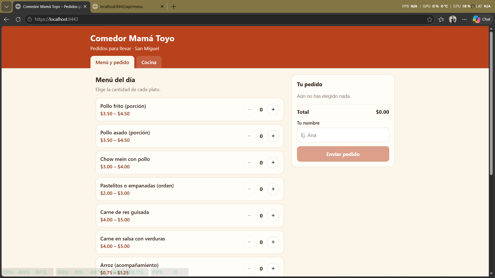
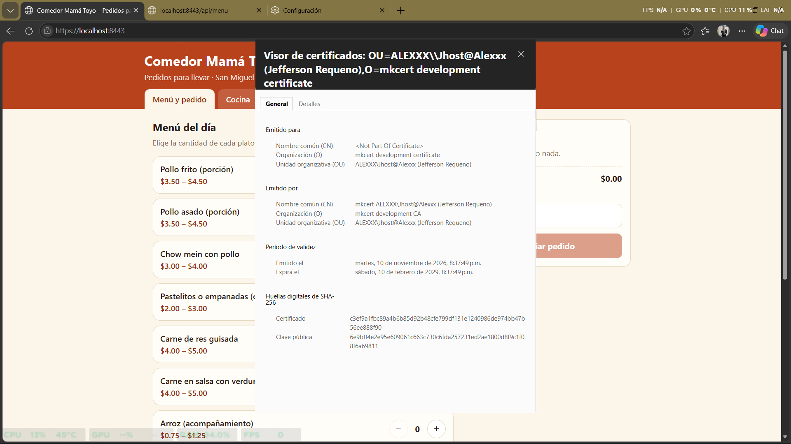
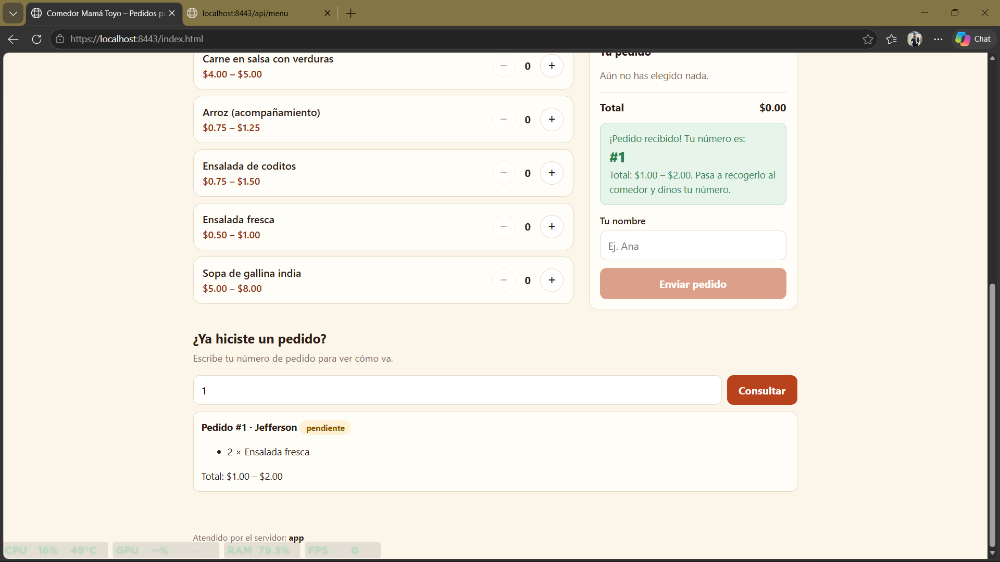
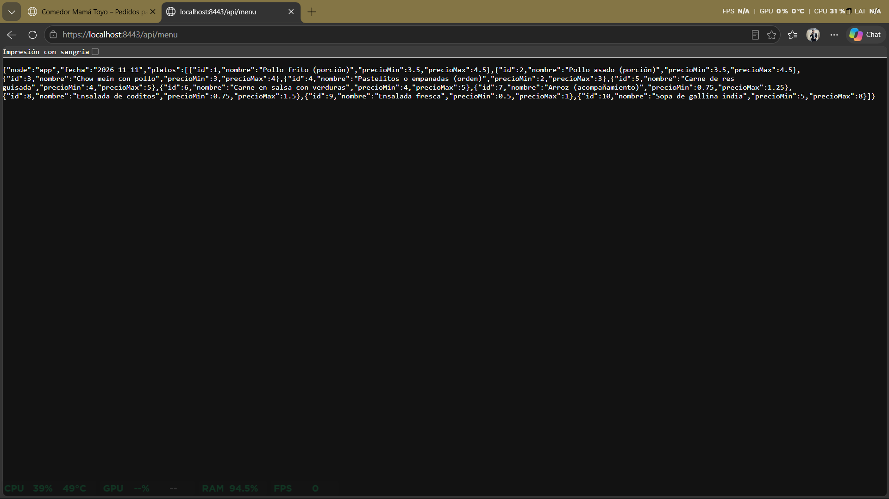
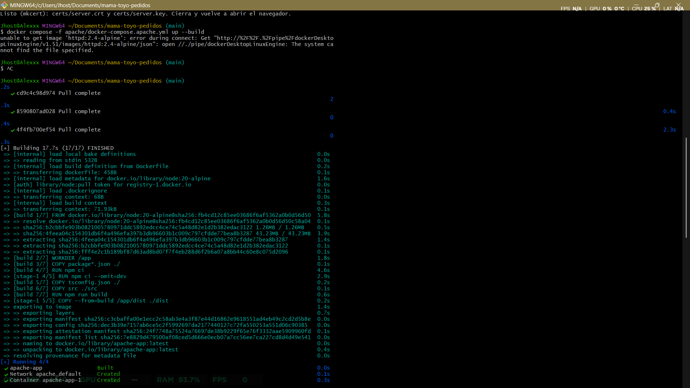

# Evidencias de HTTPS y funcionamiento (Fase 2)

Capturas del sitio funcionando en `https://localhost:8443`, con el certificado generado por mkcert.

## 1. Sitio cargando con el candado de seguridad

## 2. Detalle del certificado

## 3. Pedido creado desde la interfaz

## 4. La API respondiendo a través del reverse proxy

`https://localhost:8443/api/menu`

## 5. Apache y el contenedor Express corriendo

Salida de `docker compose -f apache/docker-compose.apache.yml ps`.

